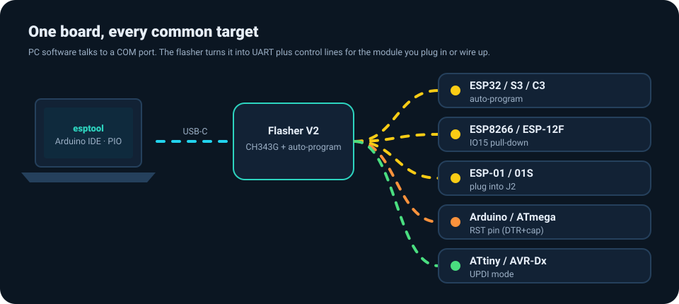
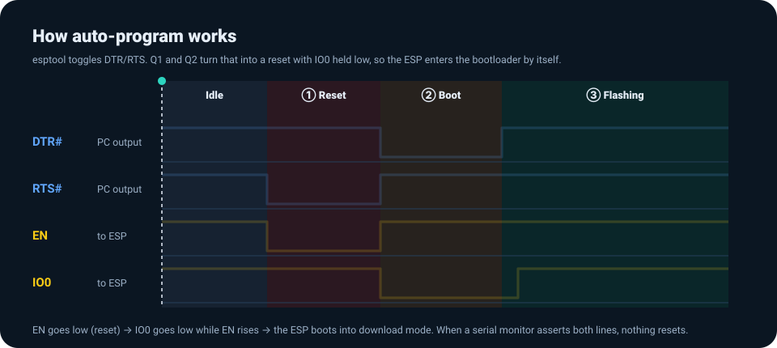
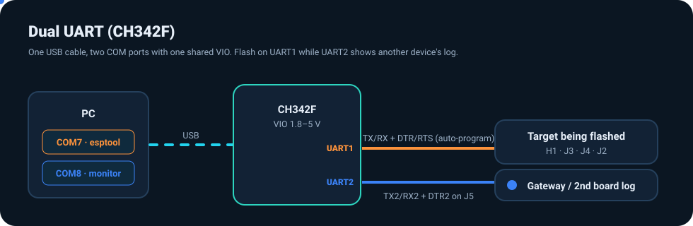

<p align="center"></p>

# Universal USB Flasher V2

**One USB-C board to flash ESP32, ESP8266 (ESP-12F, ESP-01), Arduino/ATmega and UPDI AVR chips, with a second UART to watch another device.**
True 3.3 V / 5 V logic, an ESP-Prog compatible port, a plug-in ESP-01 socket, automatic reset/boot, current-limited target power and ESD on every line.

> **Status: design stage (V2.1).** Netlist, LCSC BOM, 8-page EasyEDA pin list and placement are done and generated from one design file. The schematic and PCB are being drawn in EasyEDA. **Nothing has been built or tested on hardware yet.** This is V2 of [Universal-USB-To-Serial-Flasher](https://github.com/ElectroIoT/Universal-USB-To-Serial-Flasher) (CH340C). See [what V2 fixes](docs/V1-review.md).

| | |
|---|---|
| USB-UART | **WCH CH342F dual UART** (QFN-24), VIO 1.8–5 V, up to 3 Mbaud, two COM ports, native CDC driver on Windows 10/11, macOS and Linux |
| Logic level | **SW3**: 3.3 V or ~4.6 V (5 V rail after Schottky), red **5V IO** LED in 5 V mode |
| Targets | ESP32 / S2 / S3 / C3, ESP8266, ESP-12F, ESP-01/01S, boards with an ESP-Prog header, ATmega328P, Pro Mini, LGT8F328P, ATtiny 0/1/2-series, AVR-DA/DB/DD |
| Target power | 3.3 V and 5 V through **current-limited TPS2553 switches** (≈0.61 A / ≈0.51 A), **POWER-CYCLE** button, **OVERLOAD** LED |
| Ports | H1 1×11 · **J3 ESP-Prog 2×3 1.27 mm** · J4 2×3 2.54 mm (pogo / cable) · J5 UART2 · J2 ESP-01 socket |
| Board | 80 × 40 mm, 2-layer, 1.6 mm. All parts on LCSC |
| Interactive guide | [`docs/index.html`](docs/index.html): BOM, 8-page schematic and placement **tick-lists** for EasyEDA |
| Wiring diagrams | [`docs/schematic-wiring.html`](docs/schematic-wiring.html): every part drawn like its EasyEDA symbol with the net label for each pin, page by page |
| Build guide | [`docs/build-guide.html`](docs/build-guide.html): 7 steps from EasyEDA to first flash, LCSC order calculator, soldering order, bring-up test log with pass/fail |
| Licence | [CERN-OHL-P-2.0](LICENSE) |

---

## Contents
- [Features](#features)
- [How it works](#how-it-works)
- [Pinout](#pinout)
- [Wiring cheat-sheet](#wiring-cheat-sheet)
- [Bill of materials](#bill-of-materials)
- [Schematic pages (EasyEDA)](#schematic-pages-easyeda)
- [PCB placement](#pcb-placement)
- [Bring-up test plan](#bring-up-test-plan)
- [Roadmap](#roadmap)
- [Repository layout](#repository-layout)

---

## Features

<p align="center"></p>

- 🔀 **Dual UART (CH342F).** Two COM ports from one USB cable: UART1 flashes the target, UART2 on J5 watches a second device's log.
- ⚡ **3.3 V / 5 V logic switch + warning LED.** CH342F VIO follows SW3 for both UARTs. A PNP lights the red **5V IO** LED whenever the lines swing at 5 V.
- 🔁 **ESP auto-program.** Two MMBT3904 transistors (NodeMCU circuit) drive EN and IO0, so esptool, Arduino IDE and PlatformIO flash with no button pressing.
- 🔌 **ESP-Prog compatible port.** J3 is Espressif's 2×3 1.27 mm PROG box header; J4 has the same pinout at 2.54 mm.
- 📐 **PROG pogo-pad standard.** Future boards carry 6 bare pads in ESP-Prog order at 2.54 mm; a pogo jig on J4 flashes them with no header.
- 🔋 **Current-limited target power.** Two TPS2553 switches cut a short in microseconds. Hold **POWER-CYCLE** (SW5) to switch the target off; **OVERLOAD** lights on a trip.
- 🛡️ **ESD on every line.** USBLC6-2SC6 on USB, two USBLC6-4SC6 on TX, RX, DTR, RTS, EN, IO0, TX2 and RX2, plus a 500 mA PTC and a Schottky back-feed diode.
- 📡 **ESP-01 socket (J2).** Plug in an ESP-01/01S and flash, with no wires. GPIO2/RST/CH_PD pull-ups are on the board.
- 🧩 **Bare ESP-12F / WROOM support.** EN and IO0 pull-ups, plus an IO15 pin with a 10k pull-down.
- ♾️ **Arduino auto-reset pin.** RST = DTR# through 100 nF, with a 10k pull-up.
- 🔧 **UPDI mode (SW4).** TX→4.7k→RX turns the RX pin into a SerialUPDI programmer.
- 🔧 **SJ1/SJ2 auto-program jumpers**: 2-pin headers (C492401) with jumper caps (C5305) fitted. Pull the caps to turn UART1 into a plain USB-UART.
- 💡 **6 LEDs.** Target PWR, TX, RX, UART2 RX, 5V IO, OVERLOAD.
- 🎨 **Colour-coded silkscreen**, kept from V1.

---

## How it works

### 1. Power path
<p align="center"></p>

USB VBUS goes through the **500 mA polyfuse F1** (`VBUS_F`). That feeds the CH342F core (VDD5 + VBUS sense) and, via the **Schottky D1**, the `+5V` rail (~4.65 V). The **SGM2212 LDO** makes `+3V3` (800 mA). The target never sees these rails directly: it gets `+3V3_T` and `+5V_T` from the switches below. D1 stops a self-powered 5 V target from back-feeding the PC.

### 2. Current-limited target power
<p align="center"></p>

| Switch | IN | OUT | R<sub>ILIM</sub> | Limit (TI formula, min / typ / max) | Feeds |
|---|---|---|---|---|---|
| U4 TPS2553 | +3V3 | +3V3_T | 43k | ≈ 0.55 / 0.61 / 0.67 A | H1-1, J2 VCC, J3/J4 VDD, EN/IO0/ESP-01 pull-ups |
| U5 TPS2553 | +5V | +5V_T | 51k | ≈ 0.46 / 0.51 / 0.57 A | H1-2 |

Both EN pins share `TPWR_EN` (100k pull-up to +3V3). Holding **SW5** pulls it low, so both target rails switch off: an instant power-cycle without unplugging USB. The open-drain FAULT# outputs are wired together and drive the red **OVERLOAD** LED. TPS2553 pinout (SOT-23-6): 1 IN · 2 GND · 3 EN · 4 FAULT# · 5 ILIM · 6 OUT.

### 3. Auto-program (ESP32 / ESP8266)
<p align="center"></p>

| DTR# pin | RTS# pin | EN | IO0 | Meaning |
|:-:|:-:|:-:|:-:|---|
| 1 | 1 | high | high | idle / run |
| 1 | 0 | **low** | high | reset |
| 0 | 1 | high | **low** | boot (download) mode |
| 0 | 0 | high | high | both asserted (serial monitor), no reset |

- Q1: B ← DTR0# via 10k, E = RTS0#, C = EN.
- Q2: B ← RTS0# via 10k, E = DTR0#, **C = IO0**. In V1 this transistor was drawn with C and E swapped.

### 4. Logic-level switch + 5V-IO LED
<p align="center"></p>

The CH342F has one **VIO** pin for both UARTs. SW3 connects VIO to +3V3 or +5V. Q3 (MMBT3906) has its emitter on VIO and its base on +3V3 through 4.7k: at VIO = 3.3 V it is off, and at VIO ≈ 4.65 V it turns on and lights **LED5 (5V IO!)**. **Set SW3 to 3V3 before connecting any ESP** (the ESP8266/ESP32 are not 5 V tolerant).

### 5. Dual UART
<p align="center"></p>

UART0 (TXD0/RXD0/DTR0#/RTS0#) goes to H1, J3, J4 and J2 with auto-program. UART1 (TXD1/RXD1/DTR1#) goes to J5. DTR0# and DTR1# must **not** have pull-downs: a 3–8k pull-down at power-up switches the CH342 to RS485 TNOW mode.

### 6. UPDI mode
<p align="center"></p>

SW4 in UPDI links TX to RX through R15 (4.7k), the standard **SerialUPDI** adapter. Connect `RX/UPDI`, `GND` and `VCC` to the AVR and set SW3 to the AVR's voltage.

```bash
# Arduino IDE: megaTinyCore / DxCore → Programmer "SerialUPDI - 230400 baud"
pymcuprog -t uart -u COM7 -d attiny1614 write -f app.hex --erase --verify
```

### 7. ESP-Prog port and PROG pogo pads
<p align="center"></p>

J3 (1.27 mm shrouded) and J4 (2.54 mm) use Espressif's ESP-Prog **Program interface** order: 1 ESP_EN · 2 VDD · 3 ESP_TXD · 4 GND · 5 ESP_RXD · 6 ESP_IO0. ESP_TXD is the **target's** TX, so it goes to the flasher RXD. VDD is `+3V3_T`. Full pad spec for future boards: [docs/prog-pad-standard.md](docs/prog-pad-standard.md). The matching **pogo jig** (separate small PCB) is in [pogo-jig/](pogo-jig/), with an interactive page at [docs/pogo-jig.html](docs/pogo-jig.html). It works with every ESP chip (ESP8266, ESP32, S2, S3 incl. S3-MINI-1, C2, C3, C5, C6, H2, P4) and UPDI AVRs, on boards that carry the PROG pads.

<p align="center"></p>

### 8. Arduino reset
`DTR0#` → C10 100 nF → `RST`, with R14 10k to VIO. The falling edge of DTR when the IDE opens the port gives the classic Arduino auto-reset, even on a bare ATmega328P.

---

## Pinout

**H1, 1×11, 2.54 mm** (silkscreen colours in brackets)

| Pin | Label | Net | Use |
|---:|---|---|---|
| 1 | 3V3 (red) | +3V3_T | 3.3 V out, switched, limited ≈0.61 A |
| 2 | 5V (purple) | +5V_T | ~4.6 V out, switched, limited ≈0.51 A |
| 3 | GND (black) | GND | ground |
| 4 | TX (orange) | TXD | flasher TX → target RX |
| 5 | RX/UPDI (green) | RXD | flasher RX ← target TX; UPDI pin in UPDI mode |
| 6 | DTR (blue) | DTR_N | raw DTR0# |
| 7 | RTS (blue) | RTS_N | raw RTS0# |
| 8 | RST (yellow) | RST | Arduino reset (DTR# via 100 nF) |
| 9 | EN (yellow) | EN | ESP EN/CH_PD (auto-program) |
| 10 | IO0 (yellow) | IO0 | ESP boot strap (auto-program) |
| 11 | IO15 (grey) | IO15 | 10k pull-down for bare ESP8266 |

**J3 / J4, ESP-Prog PROG order** · **J5, UART2**

| Pin | J3 / J4 | Flasher net | | J5 | Use |
|---:|---|---|---|---|---|
| 1 | ESP_EN | EN | | GND | ground |
| 2 | VDD | +3V3_T | | TX2 | → device RX |
| 3 | ESP_TXD (target TX) | RXD | | RX2 | ← device TX (blue LED) |
| 4 | GND | GND | | DTR2 | raw DTR1# |
| 5 | ESP_RXD (target RX) | TXD | | | |
| 6 | ESP_IO0 | IO0 | | | |

**J2, ESP-01 socket (2×4 female)**, component side up, antenna pointing away from the header:
```
 GND   GPIO2  GPIO0  RXD
 TXD   CH_PD  RST    VCC
```

**CH342F (U2, QFN-24)**: 0 EP GND · 1 RI0# NC · 2 GND · 3 UD+ · 4 UD− · 5 VIO · 6 V3 (100 nF only) · 7 VDD5 · 8 VBUS · 9 RST# NC · 10 CTS1# NC · 11 RTS1# NC · 12 RXD1 · 13 TXD1 · 14 DSR1# NC · 15 DTR1# · 16 DCD1# NC · 17 RI1# NC · 18 CTS0# NC · 19 RTS0# · 20 RXD0 · 21 TXD0 · 22 DSR0# NC · 23 DTR0# · 24 DCD0# NC

---

## Wiring cheat-sheet

| Target | SW3 | SW4 | Connect |
|---|:-:|:-:|---|
| ESP32 / ESP8266 dev board | 3V3 | UART | 3V3 · GND · TX→RX · RX←TX · EN · IO0 |
| Board with an ESP-Prog PROG header | 3V3 | UART | 1.27 mm 2×3 cable into **J3** (or 2.54 mm into J4) |
| Board with ElectroIoT PROG pads | 3V3 | UART | pogo jig on **J4** |
| Bare ESP-12F | 3V3 | UART | 3V3 · GND · TX · RX · EN · IO0 · IO15 |
| Bare ESP32-WROOM / C3 / S3 | 3V3 | UART | 3V3 · GND · TX · RX · EN · IO0 |
| ESP-01 / 01S | **3V3** | UART | plug into J2 |
| Arduino Pro Mini 5 V / bare ATmega328P | 5V | UART | 5V · GND · TX · RX · RST |
| Arduino Pro Mini 3.3 V | 3V3 | UART | 3V3 · GND · TX · RX · RST |
| ATtiny1614 / AVR-Dx | target V | **UPDI** | VCC · GND · RX/UPDI |
| Second device's log | its V | – | **J5**: GND · TX2→RX · RX2←TX (second COM port) |

```bash
esptool.py --port COM7 --baud 921600 write_flash 0x0 firmware.bin
```
To power-cycle the target, hold **POWER** (SW5) for a second.

---

## Bill of materials

Full CSV: [`hardware/BOM_V2_LCSC.csv`](hardware/BOM_V2_LCSC.csv). LCSC numbers were looked up on 2026-11-12/13. The interactive BOM with tick boxes is in [`docs/index.html`](docs/index.html#bom).

<!-- BOM:START -->
| Ref | Qty | Part | Package | LCSC | Notes |
|---|:-:|---|---|---|---|
| U2 | 1 | CH342F: USB dual-UART bridge with VIO (1.8–5 V I/O) | QFN-24 4×4 | [C2841530](https://www.lcsc.com/product-detail/C2841530.html) | QFN 0.5 mm: JLC assembly or hot air |
| C2, C3, C4 | 3 | CC0805KRX7R9BB104: 100 nF X7R: VDD5, V3, VIO decoupling | 0805 | [C49678](https://www.lcsc.com/product-detail/C49678.html) |  |
| R4, R5, R6 | 3 | 0805W8F2201T5E: 2.2k: TX / RX / RX2 LEDs | 0805 | [C17520](https://www.lcsc.com/product-detail/C17520.html) |  |
| LED2 | 1 | NCD0805O1: Orange LED: TX | 0805 | [C84262](https://www.lcsc.com/product-detail/C84262.html) |  |
| LED3 | 1 | XL-2012UYC: Yellow LED: RX | 0805 | [C965814](https://www.lcsc.com/product-detail/C965814.html) |  |
| LED4 | 1 | XL-2012UBC: Blue LED: UART2 RX | 0805 | [C965817](https://www.lcsc.com/product-detail/C965817.html) |  |
| USB1 | 1 | TYPE-C 16PIN 2MD(073): USB-C 16-pin receptacle | SMD | [C2765186](https://www.lcsc.com/product-detail/C2765186.html) |  |
| U3 | 1 | USBLC6-2SC6: ESD array D+/D−/VBUS | SOT-23-6 | [C7519](https://www.lcsc.com/product-detail/C7519.html) |  |
| U6, U7 | 2 | USBLC6-4SC6: 4-line ESD array: header TX/RX/DTR/RTS/EN/IO0/TX2/RX2 | SOT-23-6 | [C111212](https://www.lcsc.com/product-detail/C111212.html) |  |
| R1, R2 | 2 | 0805W8F5101T5E: 5.1k 1%: USB-C CC pull-downs | 0805 | [C27834](https://www.lcsc.com/product-detail/C27834.html) |  |
| F1 | 1 | JK-nSMD050-16: PTC fuse 500 mA hold / 1 A trip, 16 V | 1206 | [C2680506](https://www.lcsc.com/product-detail/C2680506.html) |  |
| D1 | 1 | 1N5819HW-7-F: Schottky 40 V 1 A back-feed diode | SOD-123 | [C82544](https://www.lcsc.com/product-detail/C82544.html) |  |
| U1 | 1 | SGM2212-3.3XKC3G/TR: 3.3 V 800 mA LDO | SOT-223 | [C3294699](https://www.lcsc.com/product-detail/C3294699.html) |  |
| C1, C5 | 2 | CL21A106KAYNNNE: 10 µF 25 V X5R: VBUS / LDO in | 0805 | [C15850](https://www.lcsc.com/product-detail/C15850.html) |  |
| C6, C8 | 2 | CL21A226MAQNNNE: 22 µF 25 V X5R: LDO out / ESP-01 bulk | 0805 | [C45783](https://www.lcsc.com/product-detail/C45783.html) |  |
| C7 | 1 | CC0805KRX7R9BB104: 100 nF X7R: LDO out | 0805 | [C49678](https://www.lcsc.com/product-detail/C49678.html) |  |
| Q3 | 1 | MMBT3906LT1G: PNP: lights 5V-IO LED when VIO > 3V3 | SOT-23 | [C53444](https://www.lcsc.com/product-detail/C53444.html) | B=1 E=2 C=3 |
| R16 | 1 | 0805W8F4701T5E: 4.7k: Q3 base | 0805 | [C17673](https://www.lcsc.com/product-detail/C17673.html) |  |
| R17 | 1 | RC0805FR-071KL: 1k: 5V-IO LED | 0805 | [C95781](https://www.lcsc.com/product-detail/C95781.html) |  |
| LED5 | 1 | NCD0805R1: Red LED: 5V IO warning | 0805 | [C84256](https://www.lcsc.com/product-detail/C84256.html) |  |
| U4, U5 | 2 | TPS2553DBVR: Current-limited power switch with FAULT# (3V3_T, 5V_T) | SOT-23-6 | [C55266](https://www.lcsc.com/product-detail/C55266.html) | Pinout 1 IN 2 GND 3 EN 4 FAULT# 5 ILIM 6 OUT |
| R18 | 1 | 0805W8F4302T5E: 43k 1%: U4 ILIM (≈0.61 A) | 0805 | [C17695](https://www.lcsc.com/product-detail/C17695.html) |  |
| R19 | 1 | 0805W8F5102T5E: 51k 1%: U5 ILIM (≈0.51 A) | 0805 | [C17737](https://www.lcsc.com/product-detail/C17737.html) |  |
| R20 | 1 | RC0805FR-07100KL: 100k: TPWR_EN pull-up | 0805 | [C96346](https://www.lcsc.com/product-detail/C96346.html) |  |
| C11, C13 | 2 | CC0805KRX7R9BB104: 100 nF: switch inputs | 0805 | [C49678](https://www.lcsc.com/product-detail/C49678.html) |  |
| C12, C14 | 2 | CL21A106KAYNNNE: 10 µF: switched outputs | 0805 | [C15850](https://www.lcsc.com/product-detail/C15850.html) |  |
| SW5 | 1 | TS-1088-AR02016: Tactile switch: POWER-CYCLE | SMD 3.9×3.0 | [C720477](https://www.lcsc.com/product-detail/C720477.html) |  |
| LED1 | 1 | NCD0805G1: Green LED: target PWR | 0805 | [C84260](https://www.lcsc.com/product-detail/C84260.html) |  |
| LED6 | 1 | NCD0805R1: Red LED: OVERLOAD (FAULT#) | 0805 | [C84256](https://www.lcsc.com/product-detail/C84256.html) |  |
| R3, R21 | 2 | RC0805FR-071KL: 1k: PWR / OVERLOAD LEDs | 0805 | [C95781](https://www.lcsc.com/product-detail/C95781.html) |  |
| Q1, Q2 | 2 | MMBT3904LT1G: NPN auto-program transistors | SOT-23 | [C81464](https://www.lcsc.com/product-detail/C81464.html) | B=1 E=2 C=3 |
| R7, R8 | 2 | RC0805FR-0710KL: 10k: Q1/Q2 base resistors | 0805 | [C84376](https://www.lcsc.com/product-detail/C84376.html) |  |
| SJ1, SJ2 | 2 | PZ254V-11-02P: 2-pin male header 2.54 mm: auto-program enable (fit cap = ON) | THT | [C492401](https://www.lcsc.com/product-detail/C492401.html) | Silk: AUTO-PROG (cap = ON) |
| R9, R10, R11, R12, R13, R14 | 6 | RC0805FR-0710KL: 10k: EN/IO0 pull-ups, IO15 pull-down, ESP-01 RST/GPIO2, Arduino RST | 0805 | [C84376](https://www.lcsc.com/product-detail/C84376.html) |  |
| C9, C10 | 2 | CC0805KRX7R9BB104: 100 nF: EN filter, Arduino auto-reset | 0805 | [C49678](https://www.lcsc.com/product-detail/C49678.html) |  |
| R15 | 1 | 0805W8F4701T5E: 4.7k: UPDI series resistor | 0805 | [C17673](https://www.lcsc.com/product-detail/C17673.html) |  |
| SW1, SW2 | 2 | TS-1088-AR02016: Tactile switch RESET / BOOT | SMD 3.9×3.0 | [C720477](https://www.lcsc.com/product-detail/C720477.html) |  |
| SW3, SW4 | 2 | MSK12C02: SPDT slide: IO 3V3/5V · UART/UPDI | SMD | [C431540](https://www.lcsc.com/product-detail/C431540.html) |  |
| H1 | 1 | PZ254V-11-11P: 1×11 male header 2.54 mm | THT | [C2840011](https://www.lcsc.com/product-detail/C2840011.html) |  |
| J2 | 1 | PM254-2-04-Z-8.5: 2×4 female header 2.54 mm (ESP-01) | THT | [C2897405](https://www.lcsc.com/product-detail/C2897405.html) |  |
| J3 | 1 | HX JN1.27-2x3P ZZ H4.9: 2×3 1.27 mm IDC box header (ESP-Prog PROG) | THT | [C42372545](https://www.lcsc.com/product-detail/C42372545.html) | ⚠️ Check datasheet: shrouded + keyed |
| J4 | 1 | 2.54-2*3P: 2×3 2.54 mm male header (PROG pogo jig / 2.54 cable) | THT | [C65114](https://www.lcsc.com/product-detail/C65114.html) |  |
| J5 | 1 | PZ254V-11-04P: 1×4 male header 2.54 mm (UART2) | THT | [C2691448](https://www.lcsc.com/product-detail/C2691448.html) |  |
| CAP1, CAP2 | 2 | 2.54 (open-top): Jumper cap 2.54 mm for SJ1/SJ2 (fit both = auto-program on) | 2.54 mm | [C5305](https://www.lcsc.com/product-detail/C5305.html) | Not a schematic part: order with the headers |

**68 parts · 35 unique LCSC numbers · ≈$5.34 in captured LCSC prices per board** (plus a little for lines without a captured price; no PCB or shipping).
<!-- BOM:END -->

> **U2 CH342F is QFN-24 (0.5 mm pitch):** order it JLCPCB-assembled, or use hot air and paste. **J3:** confirm in the datasheet that C42372545 is shrouded and keyed.

---

## Schematic pages (EasyEDA)

The schematic is split into 8 EasyEDA pages (matching the EasyEDA file). Visual per-pin wiring: [`docs/schematic-wiring.html`](docs/schematic-wiring.html). **Every pin with its pin number, net, connected pins and No-Connect flags** is in [`hardware/schematic-pages.md`](hardware/schematic-pages.md). The interactive tick-list is in [`docs/index.html`](docs/index.html#sch-check).

<!-- PAGES:START -->
| Page | Parts | No-Connect flags |
|---|---|---|
| Page 1 · Power | F1, C1, D1, C5, U1, C6, C7, Q3, R16, R17, LED5, C8 | none |
| Page 2 · Target Power | U4, R18, C11, C12, U5, R19, C13, C14, R20, SW5, R21, LED6, R3, LED1 | none |
| Page 3 · USB+ESD | USB1, R1, R2, U3, U6, U7 | USB1.B8 SBU2, USB1.A8 SBU1 |
| Page 4 · USB-UART | U2, C2, C3, C4, R4, LED2, R5, LED3, R6, LED4 | U2.1 RI0#, U2.9 RST#, U2.10 CTS1#, U2.11 RTS1#, U2.14 DSR1#, U2.16 DCD1#, U2.17 RI1#, U2.18 CTS0#, U2.22 DSR0#, U2.24 DCD0# |
| Page 5 · Auto-program | SJ1, SJ2, R7, R8, Q1, Q2 | none |
| Page 6 · Target I/O | R9, C9, R10, R11, C10, R14, R15, R12, R13 | none |
| Page 7 · LEDs + Switches | SW3, SW1, SW2, SW4 | SW4.3 throw B (UART) |
| Page 8 · Connectors | H1, J2, J3, J4, J5 | none |
<!-- PAGES:END -->

GND, +3V3 and +5V use global power symbols. Every other net shared between pages needs a net label with the same name. Cross-check the finished schematic with **Design → Netlist** against [`hardware/netlist.csv`](hardware/netlist.csv).

---

## PCB placement

80 × 40 mm, 2 layers. Power runs left → right, the CH342F sits in the middle with the target switches above and below it, the header ESD arrays sit next to H1, and the ESP-01 hangs off the bottom edge.
Starting coordinates for every footprint are in [`hardware/placement.csv`](hardware/placement.csv). The board map with tick boxes is in [`docs/index.html`](docs/index.html#placement).

- U3 within 3 mm of USB1. Keep D+/D− short and side by side over solid GND.
- C2/C3/C4 within 2 mm of U2 pins 7/6/5. QFN exposed pad to GND with 4 vias.
- R18/R19 right next to the U4/U5 ILIM pins (short traces set the current limit accurately).
- U6/U7 between the header pins and everything else, with short GND vias.
- SOT-223 tab: ≥ 1 cm² of copper + vias (ESP32 Wi-Fi peaks reach ~500 mA).
- SW5 and SW1–SW4 on the top edge: `POWER` `RESET` `BOOT` `IO 3V3|5V` `UART|UPDI`.
- Test pads: VBUS_F, +5V, +3V3, +3V3_T, +5V_T, VIO, GND, TXD, RXD, TX2, RX2, DTR#, RTS#.

---

## Bring-up test plan
1. Before fitting U1/U2, check for shorts between VBUS / +5V / +3V3 / +3V3_T / +5V_T and GND.
2. Rails: +5V ≈ 4.6–4.7 V, +3V3 = 3.30 V, +3V3_T/+5V_T follow them, VIO follows SW3, PWR LED on.
3. **Two** COM ports appear (UART1 = H1/J3/J4, UART2 = J5).
4. Loopback TX↔RX and TX2↔RX2 at 115200 and 2 Mbaud. TX, RX and RX2 LEDs blink.
5. 5V-IO LED: off with SW3 = 3V3, on with SW3 = 5V.
6. Hold SW5: +3V3_T and +5V_T drop to 0 V. Release: they come back.
7. Load +3V3_T with ≈0.8 A: the current holds at ≈0.6 A and OVERLOAD lights. Repeat on +5V_T (≈0.5 A).
8. `esptool.py chip_id` through H1, then through J3 with an ESP-Prog cable.
9. Flash an ESP32 DevKit, bare ESP-12F, ESP-01, Pro Mini 5 V (RST) and ATtiny1614 (UPDI).

---

## Roadmap

Done in V2.1: dual UART, ESP-Prog port, current-limited target power, header ESD, 5V-IO LED, PROG pogo-pad standard, and the [pogo jig board](pogo-jig/) (design). Still open (details in [`docs/feature-ideas.md`](docs/feature-ideas.md)):

| Idea | Why |
|---|---|
| **3D-printed case** | Protects the bottom of the board and the ESP-01 overhang |
| **Stand-alone offline programmer** | ESP32-S3 + SD card + button for small production runs (separate project) |

---

## Repository layout
```
images/     animated SVG diagrams used in this README (CSS/SMIL, no JS)
docs/       index.html design page · schematic-wiring.html · build-guide.html (build steps, order calc, test log) · pogo-jig.html · V1 review · feature ideas · PROG pad standard
hardware/   BOM_V2_LCSC.csv · netlist.csv · schematic-pages.md · placement.csv   (generated)
pogo-jig/   PROG pogo jig board: README · BOM · netlist · placement
tools/      design.json (single source of truth) · build.py (validate + generate) · gen_svgs.py (images)
```

Change the design in `tools/design.json`, then run:
```bash
python tools/build.py
python tools/gen_svgs.py
```

---

Licensed under **CERN-OHL-P-2.0** (see [LICENSE](LICENSE)).

Designed by **ElectroIoT**: [electroiot.in](https://electroiot.in) · [YouTube](https://www.youtube.com/@ElectroIoT-IN) · [Instagram](https://www.instagram.com/electroiot_in)
