# ElectroIoT PROG pad standard (v1)

A 6-pad programming footprint for future ElectroIoT boards. You flash them with a pogo jig plugged into **J4** of the Universal USB Flasher V2, or with a 2.54 mm cable. No header needs to be soldered on the target.

## Pin order
Same order as Espressif's ESP-Prog **Program interface**, so the same cable/jig also fits ESP-Prog-style headers:

| Pad | Signal | Target side |
|---:|---|---|
| 1 | ESP_EN | EN / CH_PD (keep the board's own 10k pull-up + 1 µF or 100 nF) |
| 2 | VDD | 3.3 V supply in (from the flasher's current-limited +3V3_T, ≈0.6 A max) |
| 3 | ESP_TXD | the target MCU's **TX** |
| 4 | GND | ground |
| 5 | ESP_RXD | the target MCU's **RX** |
| 6 | ESP_IO0 | GPIO0 / BOOT strap (keep the board's own pull-up) |

Pads 1/2 form the first row, 3/4 the second and 5/6 the third. That matches a 2×3 header with pin 1 marked.

## Footprint
| Item | Value |
|---|---|
| Grid | 2 × 3, 2.54 mm pitch |
| Pads | Ø 1.5–1.8 mm round, top copper, solder mask opening +0.1 mm, **no paste** |
| Keep-out | 1 mm around the pad group: no parts, no silk |
| Locating holes (optional) | 2 × Ø 1.0 mm NPTH, centred 2.54 mm beyond pads 1 and 6 along the long axis |
| Silk | "PROG" label and a dot at pad 1 |
| Pogo pins | Jig uses 3 × CHIN-BAN PG2541-02-002P strips (LCSC C49451500, plunger Ø0.90 mm, 120 g) |

## Rules for the target board
- Keep EN and IO0 pull-ups on the target. The flasher also has 10k pull-ups on +3V3_T, so the two in parallel are fine.
- No series resistors larger than 470 Ω on TX/RX.
- If the target also has its own USB, it must not back-feed VDD. Use a diode or keep VDD unconnected and power the board itself.
- ESP8266 targets still need GPIO15 low and GPIO2 high at boot, done on the target board.

## Jig
The matching pogo jig board (design, netlist, BOM, placement) is in [pogo-jig/](../pogo-jig/).
