# PROG pogo jig

A small "pen" board that flashes any board with the [ElectroIoT PROG pad standard](../docs/prog-pad-standard.md) (6 bare pads, ESP-Prog order, 2.54 mm). No header is soldered on the target. Plug the jig into **J4** of the Universal USB Flasher V2 with a 6-way 2.54 mm cable, press it on the pads, and flash. Auto-program (EN/IO0) works through the jig.

> **Interactive page:** [docs/pogo-jig.html](../docs/pogo-jig.html): supported-chip table, pick-your-chip pad map, BOM, placement and assembly tick-lists.

> **Status: design only.** Netlist, BOM and placement are ready. You draw the PCB in EasyEDA. Not built or tested.

## Supported chips

The jig carries only EN, 3.3 V, TX, RX, GND and one boot pin (pulled low by the flasher's auto-program). So it works with **every chip whose ROM bootloader is entered by holding one pin low during reset over UART**: the whole ESP family, plus UPDI AVRs through a wiring variant.

> The pogo pins press on **pads on your own PCB**, not on a module's edge. An ESP-12F, ESP32-S3-MINI-1 or ESP32-C6-MINI-1 is supported when the board you design around it has the 6 PROG pads wired as below. For a loose module, use the flasher's H1 wires or the ESP-01 socket.

| Chip | Example modules | Pad 3 ← target TX | Pad 5 → target RX | Pad 6 boot pin | Target board must add | Status |
|---|---|---|---|---|---|---|
| ESP8266 | ESP-12F · ESP-12E · ESP-07 | GPIO1 | GPIO3 | GPIO0 | GPIO15 10k to GND, GPIO2 10k to 3V3 | ✓ |
| ESP32 | WROOM-32E · WROVER-E · PICO-D4 | GPIO1 | GPIO3 | GPIO0 | GPIO2 low/floating, GPIO12 low (module default) | ✓ |
| ESP32-S2 | S2-MINI-1 · S2-WROOM | GPIO43 | GPIO44 | GPIO0 | GPIO46 low/floating | ✓ |
| ESP32-S3 | S3-WROOM-1 · **S3-MINI-1** · S3-WROOM-2 | GPIO43 | GPIO44 | GPIO0 | GPIO46 low/floating | ✓ |
| ESP32-C2 | ESP8684-MINI / WROOM | GPIO20 | GPIO19 | GPIO9 | GPIO8 10k to 3V3 | ✓ |
| ESP32-C3 | C3-MINI-1 · C3-WROOM-02 | GPIO21 | GPIO20 | GPIO9 | GPIO8 10k to 3V3 | ✓ |
| ESP32-C5 | C5-WROOM-1 | GPIO11 | GPIO12 | GPIO28 | GPIO27 10k to 3V3 | ✓ |
| ESP32-C6 | **C6-MINI-1** · C6-WROOM-1 | GPIO16 | GPIO17 | GPIO9 | GPIO8 10k to 3V3 | ✓ |
| ESP32-H2 | H2-MINI-1 | GPIO24 | GPIO23 | GPIO9 | GPIO8 10k to 3V3 | ✓ |
| ESP32-P4 | P4 boards | GPIO37 | GPIO38 | GPIO35 | GPIO36 10k to 3V3 (own power tree) | ✓ |
| ATtiny 0/1/2 · AVR-Dx | ATtiny1614 · AVR128DA | UPDI on pad 3 | – | – | Only pads 2/3/4 used, flasher SW4 = UPDI | ◐ variant |
| ATmega328P / Arduino | Pro Mini | – | – | – | Needs DTR-capacitor reset: use flasher H1 RST | ✗ |
| STM32 · RP2040 · nRF52 · SAMD · CH32V | – | – | – | – | Different bootloader (BOOT0 high / USB / SWD) | ✗ |

On C2, C3, C6 and H2 the boot pin is **GPIO9**, not GPIO0: wire pad 6 ("IO0") to GPIO9 and pull GPIO8 high (GPIO8 = 0 with GPIO9 = 0 is invalid). Every target also keeps its own EN pull-up + 100 nF–1 µF and a boot-pin pull-up. Sources: Espressif esptool "Boot Mode Selection" docs (boot pins) and ESP-IDF `soc/<chip>/include/soc/uart_pins.h` (UART0 pins), checked 2026-11-13.

## How it works
- **P1–P3** are three CHIN-BAN **PG2541-02-002P** pogo strips (2 pins each, 2.54 mm pitch). Their housings are 5.30 × **2.50 mm**, so three strips stack at a 2.54 mm row pitch and form the 2 × 3 PROG grid.
- **J1** (2 × 3, 2.54 mm) carries the same 6 signals in the same order as the flasher's J4 and J3, so the cable is straight: pin 1 to pin 1.
- **LED1** (green) lights when VDD is present, so you see the flasher's switched +3V3_T at the tip. Hold POWER on the flasher to power-cycle the target through the jig.
- **G1/G2** (optional) are Ø1.0 mm guide pins that drop into the PROG standard's locating holes, so the pins land square on the pads.

| J1 pin | Signal | Pogo | PROG pad | Flasher J4 net |
|---:|---|---|---:|---|
| 1 | ESP_EN | P1.1 | 1 | EN |
| 2 | VDD | P1.2 | 2 | +3V3_T |
| 3 | ESP_TXD (target TX) | P2.1 | 3 | RXD |
| 4 | GND | P2.2 | 4 | GND |
| 5 | ESP_RXD (target RX) | P3.1 | 5 | TXD |
| 6 | ESP_IO0 | P3.2 | 6 | IO0 |

Full netlist: [netlist.csv](netlist.csv) · BOM: [BOM.csv](BOM.csv) · placement: [placement.csv](placement.csv)

## Bill of materials
| Ref | Qty | Part | LCSC | Notes |
|---|:-:|---|---|---|
| P1, P2, P3 | 3 | PG2541-02-002P pogo strip 2P, 2.54 mm, 13.7 mm, plunger Ø0.90 | [C49451500](https://www.lcsc.com/product-detail/C49451500.html) | ⚠️ 200 in stock (≈66 jigs); 120 g at 1.0 mm travel |
| J1 | 1 | 2 × 3 male header 2.54 mm | [C65114](https://www.lcsc.com/product-detail/C65114.html) | 44,550 in stock |
| LED1 | 1 | Green LED 0805 (NCD0805G1) | [C84260](https://www.lcsc.com/product-detail/C84260.html) | VDD present |
| R1 | 1 | 1k 0805 | [C95781](https://www.lcsc.com/product-detail/C95781.html) | LED resistor |
| G1, G2 | 2 | Ø1.0 × 16 mm steel dowel pin | generic | optional guide pins |
| – | 1 | 6-way 2.54 mm F–F IDC ribbon or Dupont cable | generic | pin 1 to pin 1 |

About $1.50 in LCSC parts per jig, plus the PCB.

## Board
- **Outline:** 20 × 47 mm, pen shape (wide top for J1, tapered 12 mm tip). Polygon: (0,0) (20,0) (20,28) (16,34) (16,47) (4,47) (4,34) (0,28). **1.6 mm** thick, because the pogo tails are only 1.7 mm long.
- **Top side:** J1 at (10, 6), LED1 at (10, 16), R1 at (10, 19). Silk: "PROG JIG", "J4 →" and a pin-1 dot.
- **Bottom side (pogo tip):**

| Pogo | Pin 1 at (x, y) | Pin 2 at (x, y) |
|---|---|---|
| P1 | (8.73, 36.92) EN | (11.27, 36.92) VDD |
| P2 | (8.73, 39.46) ESP_TXD | (11.27, 39.46) GND |
| P3 | (8.73, 42.00) ESP_RXD | (11.27, 42.00) IO0 |

- **Guide holes:** Ø1.0 mm plated at (8.73, 34.38) and (11.27, 44.54). These match the standard's locating holes, 2.54 mm beyond pads 1 and 6.
- **Pogo holes:** the tails are Ø0.80 mm. Use a Ø1.0 mm drill with a Ø1.6 mm pad.
- **Orientation:** coordinates are a **top view**. The jig is pressed bottom-down, so its top view lines up with the target's top view (no mirror). When you place the pogo footprints on the bottom layer, EasyEDA mirrors them: check that each pin 1 still lands on the coordinates above.
- **Routing:** 6 short traces from J1 to the pogo tails, plus R1/LED1 on VDD/GND. 0.3 mm traces are plenty (≤ 0.6 A).

## Assembly
1. Fit and solder J1, R1 and LED1 on the top side first.
2. Insert P1–P3 from the bottom with their housings flat on the board. The three housings may just touch (2.50 mm housings on a 2.54 mm pitch).
3. Press the board, pins down, onto a flat surface so all six plungers sit at the same height. Tack one pin per strip, check they are square, then solder the rest.
4. Optional: press the two dowels into G1/G2 so they stick out about 12.8 mm below the board, about 1 mm beyond the uncompressed pogo tips.

## Use
1. Flasher: SW3 = **3V3**, SW4 = **UART**.
2. Cable from the flasher's **J4** to the jig's **J1**, pin 1 to pin 1. J4 isn't keyed, so match the pin-1 marks.
3. Press the jig onto the target's PROG pads (pad 1 = EN, pin-1 dot). LED1 lights.
4. Flash as usual, for example `esptool.py --port COM7 write_flash 0x0 firmware.bin`. Auto-program handles reset and boot.
